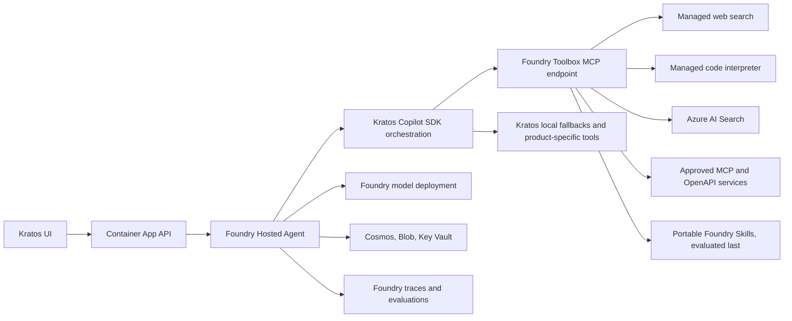

# Foundry Adoption Plan

## Goal

Use more of Microsoft Foundry's managed agent capabilities without replacing Kratos's code-centric orchestration, dynamic personas, custom UI protocol, or existing deployment model.

The target architecture keeps Kratos as a Foundry Hosted Agent and incrementally moves suitable shared capabilities into a Foundry Toolbox. Foundry becomes the managed hosting, model, identity, observability, evaluation, and tool-governance plane. Kratos continues to own persona selection, Copilot SDK orchestration, interactive workflows, and the product-specific event contract.

## Decisions

1. Keep the existing Foundry Hosted Agent and Invocations protocol.
2. Introduce Foundry Toolbox as an additional MCP source consumed by the hosted container.
3. Start with the `generic` persona and low-risk tools.
4. Preserve current tools as a fallback during migration.
5. Require evaluation evidence before making Toolbox the default or expanding it to other personas.
6. Keep prompts and persona routing in source control for now.
7. Defer Graph OBO migration until Foundry identity passthrough is proven end to end.
8. Treat Responses protocol and specialist Foundry agents as later, independent decisions.
9. Evaluate moving portable `SKILL.md` workflows into Foundry only after the managed-tool, shared-integration, evaluation, and identity work is complete.

## Implementation Status

Last updated: 2026-09-25

- [x] Confirmed Toolbox and Hosted Agent support in Sweden Central.
- [x] Added declarative `kratos-tools` provisioning with managed Web Search.
- [x] Corrected the Bicep project endpoint output to use Azure's `AI Foundry API` endpoint.
- [x] Added disabled-by-default, environment-controlled Toolbox consumption.
- [x] Added renewable managed-identity authentication through the Copilot SDK MCP auth callback.
- [x] Scoped Toolbox consumption to the `generic` persona and removed duplicate local `web_search` exposure while enabled.
- [x] Deployed an active Hosted Agent and Toolbox in the `bankfdry` environment with Toolbox enabled.
- [x] Added focused tests for disabled behavior, persona scoping, and endpoint-scoped authentication.
- [x] Proved an end-to-end generic Web Search invocation through Toolbox; the deployed event stream recorded a successful `kratos-tools-web_search` call with sourced results.
- [x] Fixed the eval CLI scenario filter payload to match the backend `scenarios` contract.
- [x] Confirmed platform-managed Application Insights telemetry after full Hosted Agent recreation; the reserved connection string remains absent from the agent definition and must not be declared there.
- [x] Verified a successful `execute_tool kratos-tools-web_search` dependency span in Application Insights with Foundry agent, project, session, invocation, and GenAI tool dimensions. Authentication succeeded operationally, but no dedicated auth dimension is emitted.
- [x] Recreated the deleted `bankfdry` Hosted Agent instance identity by deleting and redeploying the hosted agent, then reapplied its declarative role assignments; a minimal model invocation returned `OK`.
- [x] Deployed and verified the evaluator adapter in `bankfdry`. A post-fix Toolbox run of `generic/web-search-ai-trends` completed in 25.7 seconds, invoked `kratos-tools-web_search`, passed the aggregate, and scored Coherence 5/5, Relevance 4/5, Intent Resolution 4/5, Tool Call Accuracy 5/5, and Task Adherence 1/1. Task Adherence now executes instead of failing schema validation, explicit evaluator pass flags take precedence over numeric-score thresholds, and failed/skipped evaluators can no longer produce a false passing run summary.
- [x] Completed the disabled baseline comparison for `generic/web-search-ai-trends` in `bankfdry` and restored Toolbox immediately afterward. The local `web_search` run completed in 30.9 seconds and scored Coherence 5/5, Relevance 5/5, Intent Resolution 4/5, Tool Call Accuracy 5/5, and Task Adherence 1/1, with an aggregate pass. The earlier Toolbox run completed in 31.6 seconds with the same criterion scores and an explicit Task Adherence pass; its stored aggregate failure was produced by the older threshold-based aggregation and is not a quality difference. Deployment-spanning warm-pool sessions can retain the previous agent version, so controlled comparisons must drain the two-session pool before measuring. `bankka` remained untouched.
- [x] Added a guarded multi-run comparison command that verifies the selected azd environment, drains the warm pool after each Hosted Agent deployment, enforces release thresholds, and restores Toolbox after failures.
- [x] Ran the guarded five-sample comparison in `bankfdry` and restored Toolbox on the active Hosted Agent version. Tool routing was correct in all ten measured runs. Local tools passed 3/5 runs with a 34.3-second median and 38.4-second p95; Toolbox passed 2/5 runs with a 29.6-second median and 37.2-second p95. Toolbox latency passed the 20% regression limit, but promotion failed the 100% quality threshold. The local failures were both Task Adherence failures. Toolbox failures included Task Adherence in three runs, with one also failing Tool Call Accuracy and another also failing Intent Resolution. Keep the local fallback and investigate evaluator or response variability before promoting Toolbox or starting Code Interpreter migration.
- [x] Separated evaluation evidence retention from telemetry truncation. Completed tool events now retain up to 12,000 characters for evaluators while OpenTelemetry attributes remain capped at 2,000 characters. The focused regression test and all 15 affected backend tests pass.
- [x] Repeated the five-sample comparison after the evidence fix. Local improved to 5/5 with a 34.0-second median and 35.2-second p95. Toolbox improved to 3/5 with a 30.7-second median but failed both the quality gate and latency gate with a 43.5-second p95. The Toolbox latency outlier passed all quality criteria, so latency and quality failures were independent.
- [x] Tightened the generic prompt to treat tool output as evidence, obey explicit response constraints, and cite only sources present in tool output. A five-sample rerun kept local at 5/5 and Toolbox at 3/5; Toolbox latency passed at 38.0-second p95 versus 40.1 seconds locally.
- [x] Aligned the committed web-search scenario input with its expected one-sentence, one-citation-per-item contract and reran five samples per mode. Local passed 5/5 with a 32.4-second median and 54.6-second p95. Toolbox passed 3/5 with a 28.6-second median and 30.0-second p95. Managed `web_search` returned 10,000-12,000 characters of evidence but exposed empty tool arguments; Task Adherence intermittently treated the call as uncorroborated or counted the tool's long report as assistant prose. This is evaluator instability around the managed tool transcript, not evidence truncation or a latency regression. Promotion remains blocked, the local fallback stays in place, and Code Interpreter work remains deferred.
- [x] Replaced Task Adherence as the Web Search release decision with a deterministic gate that requires the expected completed tool, exactly five one-line numbered items, one sentence and one evidence-backed citation per item, and passing non-Task quality evaluators. The comparison now also aborts before either Hosted Agent deployment when the blob-backed scenario differs from the committed scenario; this caught an older blob override that had made the first apparent 0/5 versus 0/5 strict-format run invalid.
- [x] Synchronized the committed scenario through the evaluation API and completed the first valid deterministic five-sample comparison. Local passed 5/5 with a 28.4-second median and 37.0-second p95. Toolbox passed 2/5 with a 35.9-second median and 118.5-second p95. One Toolbox failure cited five URLs absent from tool evidence; two contract-compliant runs failed Tool Call Accuracy after repeated managed-search attempts, and the latency outlier also made redundant `web_fetch` calls. This is a Toolbox-specific quality and latency regression. Keep the local fallback, do not promote Toolbox, and keep Code Interpreter deferred.
- [x] Added generic-persona Toolbox routing guidance that permits one managed search plus at most one evidence-driven retry and prohibits `web_fetch` unless the user requests a specific page. A five-sample Toolbox diagnostic then passed 4/5 with a 33.9-second median and 38.1-second p95; every completed sample used one or two managed searches with no `web_fetch` or failed tool calls. The sole failure substituted five URLs absent from tool evidence. This was not a valid promotion comparison because the paired local run passed only 1/5 and included two Hosted Agent HTTP 409 invocation failures.
- [x] Made the comparison report invocation errors as failed samples while computing latency from completed scenarios, instead of discarding the full comparison. Focused regression coverage verifies the partial-failure behavior.
- [x] Added Toolbox-only guidance to copy citation URLs exactly from managed-search evidence and ran a warm-pool drain plus five diagnostic samples on active Hosted Agent version 27. Toolbox passed 0/5 with a 23.2-second median and 37.9-second p95: one sample failed with Hosted Agent HTTP 409, three returned prose that violated the exact five-line response contract, and one still substituted all five citation URLs. All four completed samples used exactly one managed search with no `web_fetch` or failed tool calls. The experiment was rejected and the citation-specific sentences were removed; active version 28 restores the earlier routing-only guidance. Toolbox remains unpromoted, the local fallback stays available, and Code Interpreter remains deferred.
- [x] Replaced the generic Copilot SDK MCP handoff with an application-owned Streamable HTTP bridge for `kratos-tools-web_search`. The bridge sends the documented `search_query`, preserves resource text and citation metadata, deduplicates authoritative HTTP(S) sources, and explicitly forbids invented links when Toolbox returns no source URLs. Added generic-pilot guidance that suppresses search narration and honors exact response formats, then deployed Hosted Agent version 31 with Toolbox enabled in `bankfdry`. A targeted `generic/web-search-ai-trends` run completed in 25.8 seconds, invoked the bridge once, started directly with item 1, and passed the deterministic contract with five response URLs backed by 22 evidence URLs. All 100 backend tests, focused gate tests, touched-file Ruff, format, and mypy checks pass. After installing the locked Node dependencies through the configured Azure Artifacts feed, all 15 post-deploy API smoke tests passed in 31.3 seconds.
- [x] Completed a fresh guarded five-sample comparison and restored Toolbox on active Hosted Agent version 33. Local passed 5/5 with a 29.2-second median and 34.6-second p95; Toolbox passed 5/5 with a 23.0-second median and 26.0-second p95. Every run used the expected tool, Toolbox p95 was 24.9% lower than local, and all 15 final API smoke tests passed in 24.4 seconds. Toolbox therefore passed the defined quality, reliability, and latency gates for the generic Web Search pilot and remains enabled in `bankfdry`; retain the local fallback through the cost/release observation period and rollback exercise.
- [x] Ran the API-only deployed smoke suite against `bankfdry`; it completed successfully.
- [x] Restored backend dependencies through Azure Artifacts; all 83 backend tests pass and focused evaluator lint is clean. Whole-tree Ruff still reports three unrelated existing findings.
- [x] Verified the recreated Hosted Agent identity has only the declared ARM data-plane roles (`Cognitive Services OpenAI User`, `Cognitive Services User`, `Key Vault Secrets User`, and `Storage Blob Data Reader`) plus one Cosmos DB data-plane assignment; Toolbox execution succeeds with this set.
- [x] Added invocation-level Web Search billing telemetry to both local and Toolbox adapters. Successful calls record one billable `transaction` in structured tool-event metadata and OpenTelemetry, the traces API/UI exposes the billing dimensions, and the guarded comparison estimates cost from explicitly supplied rates while failing closed if any expected call is unmetered. Billing is carried separately from retained tool evidence because large evidence is truncated at 12,000 characters. The current public list price is $14 per 1,000 Web Search transactions as of 2026-09-25; rates remain command inputs because actual agreement pricing and future rates can differ.
- [x] Deployed the structured billing meter and ran a cost-enabled five-sample comparison in `bankfdry`. All ten measured calls were observable: local and Toolbox each used five transactions, estimated at $0.070 total and $0.014 per run, so the cost-regression gate passed. Local passed 4/5 with a 29.0-second median and 35.6-second p95; Toolbox passed 4/5 with a 22.3-second median and 23.1-second p95. The local failure added a preamble and broke the exact five-item format; the Toolbox failure used one item-5 citation absent from tool evidence. All non-Task quality evaluators passed. The overall 100% quality gate therefore failed even though cost observability, equal estimated cost, and Toolbox latency passed. The comparison also exercised rollback by deploying and validating the local fallback, then restored and validated Toolbox. Toolbox remains enabled, the local fallback remains, and all 15 post-deploy API smoke tests passed.
- [x] Added a non-disruptive Toolbox-only observation mode with explicit quality, p95, complete-metering, and cost-per-run limits. The gate canonicalizes scheme/host casing, trailing path slashes, and fragments while preserving query-string distinctions, so resource-equivalent citations do not produce false failures and genuinely unsupported sources still fail.
- [ ] Web Search release observation: 1 of 3 consecutive five-run batches passes after the latest batch reset the count. The prior batches passed 5/5 with 22.5/27.6-second and 20.7/24.4-second median/p95 latency respectively, five observable transactions per batch, no unobservable managed calls, and an estimated $0.070 total/$0.014 per measured batch run; their first-to-last span exceeded 30 hours. The attempted third batch passed 3/5 with a 21.9-second median, 23.8-second p95, five observable transactions, no unobservable managed calls, and the same estimated cost. One apparent sentence-format failure came from counting the dotted abbreviation `U.S.` as a second sentence, while one Tool Call Accuracy failure came from slicing successful structured tool output mid-JSON before evaluation. The gate now masks dotted abbreviations and preserves valid JSON plus citations and billing when truncating tool evidence. Hosted-agent version 45 deployed these fixes with managed Code Interpreter still disabled/version 0; after draining both stale warm sandboxes, the reset batch 1 passed 5/5 with a 23.3-second median, 27.1-second p95, five observable transactions, no unobservable managed calls, and an estimated $0.070 total/$0.014 per measured run. The 24-hour first-to-last observation clock restarts from this corrected batch. Toolbox remains enabled.

### Remaining Work, In Order

1. Complete two more consecutive passing Web Search observation batches, with the final batch at least 24 hours after batch 1, before considering removal of the local fallback. Rollback and restoration have been exercised.
2. Evaluate Foundry-managed Code Interpreter with no-file math first, then file-transfer, package, execution-limit, persistence, cost, download-flow, and user-isolation coverage. Do not promote it while the Toolbox container context is shared across users.
3. Finish the reusable Foundry evaluation/process-evaluator path for each promoted capability.
4. Inventory and migrate eligible non-user-specific MCP, OpenAPI, and Azure AI Search integrations.
5. Complete the Graph OBO identity and security spike; retain the custom path unless Foundry preserves the current user-isolation boundary.
6. Make separate product decisions about the optional Responses protocol and specialist agents.
7. Experiment with portable Foundry Skills after the preceding work. Filesystem use alone is not a blocker; runtime dependencies and product contracts determine portability.

## Current State

Foundry currently provides:

- AI Services account, project, and model deployment.
- Managed Hosted Agent compute with a dedicated endpoint and agent identity.
- Per-session isolation and scale-to-zero behavior.
- Container versioning and lifecycle management.
- Application Insights integration and OpenTelemetry traces.
- A declaratively provisioned Toolbox whose managed Web Search is promoted for the `generic` persona in `bankfdry`.

Kratos currently provides inside the hosted container:

- Persona selection and system prompts.
- Copilot SDK session orchestration.
- The local Web Search fallback, Azure AI Search, code interpreter, CRM, and agent delegation.
- `SKILL.md` discovery and APM package management.
- MCP server discovery and per-user OBO token injection.
- Cosmos-backed application state and the custom SSE event contract.
- Evaluation scenario storage, invocation, scoring, and reporting.

Because the Hosted Agent is bring-your-own code, Foundry cannot introspect its internal Copilot SDK tools. Only capabilities registered with Foundry, such as the promoted Toolbox Web Search, are Foundry-managed and visible there.

## Target Architecture



Toolbox remains additive during migration. A tool is removed from the local registry only after its Toolbox replacement passes functional, identity, latency, cost, and evaluation checks and survives a release observation period.

## Success Criteria

- `azd up` can provision or configure the Toolbox integration without embedding environment-specific endpoints or credentials in the repository.
- Toolbox can be enabled per azd environment and disabled without rebuilding application behavior.
- The generic persona can discover and invoke the pilot Toolbox tools from the Foundry Hosted Agent.
- Existing generic web-search and computation scenarios do not regress.
- Tool calls and failures are observable in Foundry/Application Insights with stable tool names.
- Authentication uses managed identity or Foundry-managed connections; no secrets are added to manifests or images.
- Existing personas, APM skills, MCP integrations, local development, and OBO continue to work when Toolbox is disabled.
- A documented rollback returns traffic to current local tools without infrastructure teardown.

## Non-Goals

- Replacing Kratos with a prompt-only Foundry agent.
- Moving all personas or prompts into the Foundry portal.
- Replacing the frontend or backend proxy.
- Changing the Invocations protocol in the initial work.
- Migrating delegated Microsoft Graph access in the pilot.
- Forcing every local file-manipulation or workflow skill into Toolbox or a Foundry-managed runtime regardless of compatibility.

## Phase 0: Baseline and Compatibility Spike (Complete)

### Work

- Confirm Toolbox availability, API version, SDK support, and regional availability for the selected azd environment.
- Confirm Hosted Agent access to a Toolbox MCP endpoint using its dedicated agent identity.
- Record the exact Toolbox resource model and determine whether provisioning can be expressed in Bicep or requires a deployment hook/SDK call.
- Capture baseline results for:
  - `generic/web-search-ai-trends`
  - `generic/code-interpreter-math`
  - `generic/data-analysis-with-charts`
- Record response quality, expected tool selection, duration, cold-start impact, token usage where available, and failure behavior.
- Verify current tool-call events contain enough structure for Foundry process evaluators.

### Baseline Exit Criteria

- A supported provisioning and authentication path is identified.
- Baseline eval artifacts are available for comparison.
- No unsupported preview dependency is accepted without an explicit decision and rollback plan.

## Phase 1: Toolbox Foundation (Complete)

### Infrastructure

- Add a Toolbox associated with the existing Foundry project.
- Surface only non-sensitive Toolbox identifiers/endpoints as Bicep or azd outputs.
- Grant the Hosted Agent identity the minimum roles required to discover and invoke Toolbox tools.
- Prefer Foundry connections and managed identity over keys.
- Keep all deployment-specific values in azd environment outputs or environment variables.

### Runtime

- Add an opt-in configuration such as `FOUNDRY_TOOLBOX_ENABLED=false` and a runtime-resolved Toolbox endpoint/identifier.
- Register Toolbox as one MCP server in the Copilot SDK session configuration.
- Scope the pilot to the `generic` persona.
- Keep existing local tools registered while validating connectivity, but avoid exposing duplicate tool names to the model in the same session.
- Normalize Toolbox events into the existing Kratos `tool_call` stream and OpenTelemetry attributes.
- Fail closed for authentication errors and fall back only when explicitly configured.

### Tests

- Configuration parsing and disabled-by-default behavior.
- Persona scoping.
- MCP configuration construction without secret logging.
- Tool-event normalization.
- Hosted smoke invocation with Toolbox enabled and disabled.

### Foundation Exit Criteria

- Toolbox is deployable repeatedly through the project workflow.
- Enabling it for `generic` does not affect other personas.
- Disabling it restores current behavior without code or infrastructure rollback.

## Phase 2: Pilot Managed Tools

### 2A. Web Search (Promoted; Cost and Observation Pending)

Move the current web-search capability to Toolbox first.

Benefits:

- Removes the custom Responses API wrapper and endpoint transformation.
- Centralizes tool configuration and governance.
- Makes the tool visible and independently versionable in Foundry.

Acceptance criteria:

- Source citations remain available to the frontend.
- Tool naming remains compatible with existing scenarios or is migrated deliberately.
- Quality and success rate meet or exceed the baseline.
- Added latency and cost are measured and accepted.

### 2B. Code Interpreter (Next Managed-Tool Migration)

Evaluate Foundry-managed Code Interpreter against the current local Python subprocess.

Benefits:

- Stronger execution isolation and managed lifecycle.
- Better governance than arbitrary subprocess execution inside the Hosted Agent container.
- Potentially better file and execution observability.

Acceptance criteria:

- Numeric and data-analysis scenarios pass.
- Generated files can still be surfaced through the Kratos download flow.
- Required Python package behavior is documented.
- Execution limits, persistence, and cost are acceptable.

Do not remove the local interpreter until file transfer and package compatibility are proven.

Current platform constraints, verified against Microsoft documentation on 2026-09-25:

- Toolbox Code Interpreter in a Hosted Agent does not support user isolation; users in the same Foundry project share the Toolbox container context. Do not expose it to general multi-user or sensitive-file workloads unless this boundary changes or a stronger isolation design is proven.
- Start with the pure `generic/code-interpreter-math` scenario using no files or sensitive data. Treat this as a capability experiment, not a production promotion.
- Code Interpreter has a fixed package set, no outbound network access, a one-hour active session limit, and a 30-minute idle timeout. Custom packages require a different/custom interpreter path.
- Toolbox file inputs must use the resource-level Files endpoint with the project header; project-scoped uploads fail ownership verification.
- Generated files are returned as Foundry `container_id`/`file_id` annotations. Kratos must download and validate them into its `/tmp` file flow before the existing frontend download contract can be considered compatible.
- Current public list price is $0.033 per Code Interpreter session. Concurrent conversations create separate billed sessions.

Experiment sequence:

1. [x] Confirm Code Interpreter availability for the deployed model in Sweden Central and add it to a non-default Toolbox version.
2. [x] Add an application-owned `code_interpreter` MCP bridge with no-file math coverage, session billing telemetry, and fail-closed output normalization.
3. [x] Run the pure-math local-versus-Toolbox comparison with synthetic inputs only.
4. [x] Separately prove generated-file download translation and file cleanup using non-sensitive synthetic data.
5. Stop without promotion if project-shared container context cannot meet Kratos's user-isolation requirements.

No-file pilot result on 2026-09-25:

- Created immutable Toolbox version 5 with `web_search` and `code_interpreter`; the creation check confirmed the published default remained version 1.
- Called the version-specific MCP endpoint directly with a `code`-only synthetic standard-library program. `tools/list` exposed only the expected `search_query` and `code` required fields, and Code Interpreter returned mean 9, hypotenuse 5, and sum of squares 404 without an MCP error or file input.
- Added a disabled-by-default, numeric-version-pinned application bridge for the generic persona. It replaces the local interpreter only when both pilot settings are explicitly enabled, normalizes text output fail-closed, and emits one billable `session` per successful managed call.
- One local `generic/code-interpreter-math` baseline completed in 31.7 seconds without calling an interpreter; evaluator scores were Task Adherence 1, Intent Resolution 4, Coherence 4, Relevance 3, and Tool Call Accuracy 2. A later local rollback run called the interpreter, returned both expected values in 17.6 seconds, and exposed no managed-session billing.
- The first hosted-agent pilot deploy used disabled defaults because Foundry injects only variables declared in `src/hosted-agent/agent.yaml`; `azure.yaml` `config.env` is not propagated to the hosted runtime. Both live hosted-agent manifests now declare the disabled-by-default enable and version controls.
- Two application-routed managed runs completed in 18.5 and 20.3 seconds. Each used exactly one `kratos-tools-code_interpreter` call, exposed one billable session, made no local interpreter call or file reference, and returned both expected values. Task Adherence passed at 1/1, Coherence and Relevance at 4/5, Tool Call Accuracy at 5/5, and Intent Resolution at 5/5 and 4/5. At the current public rate, the two measured runs are estimated at $0.066 total/$0.033 per run.
- Rollback was exercised by deploying hosted-agent version 41 with the controls disabled/version 0, draining two stale pre-deploy warm sandboxes with no-tool synthetic requests, and confirming a fresh sandbox used only the local interpreter with no session billing. Toolbox version 5 remains immutable and unpromoted; the published default remains Web Search-only version 1.
- A direct version-5 synthetic-file probe created a 26-byte CSV with no file input. Toolbox returned text content whose private metadata contained one citation with exactly `container_id`, `file_id`, and `filename`; no file bytes or identifiers were persisted in the repository or logs.
- The project-scoped container content endpoint returned the exact expected CSV bytes. Deleting that generated file returned HTTP 200, and a follow-up content request returned HTTP 404. The two direct generated-file probes consumed two additional Code Interpreter sessions, estimated at $0.066 total at the current public rate.
- The application adapter now translates generated-file citations into unique local `/tmp` files for the existing hosted-agent collection flow. It accepts at most five allowlisted output files of at most 10 MiB each, rejects path traversal and unsupported extensions, exposes only local filename/path/size metadata, deletes each Foundry-side file even when download validation fails, and removes partial local output on failure.
- Generated-output routing remains disabled by default, immutable-version-pinned, generic-only, and restricted to synthetic output with no file inputs, user uploads, environment values, secrets, network access, or package installation. Focused adapter and routing tests pass.
- Deployed hosted-agent version 43 with the pilot pinned to Toolbox version 5, drained two stale warm sandboxes with no-tool synthetic requests, and ran one application-routed generated-file check. It made exactly one managed Code Interpreter call and zero local interpreter calls, exposed one billable session, returned a validated local `/tmp` path, and produced an exact 26-byte CSV through the existing backend download route with HTTP 200 and no application errors. This adds an estimated $0.033, bringing the three generated-file experiment sessions to $0.099 total at the current public rate.
- Rolled back to active hosted-agent version 44 with the pilot disabled/version 0, confirmed the Toolbox default remained Web Search-only version 1, and drained two pilot-era warm sandboxes. A fresh rollback conversation made exactly one local interpreter call, zero managed calls, exposed no session billing, returned the expected result, and produced no errors.
- Stop before production promotion: generated-file translation, Foundry-side cleanup, the Kratos download flow, and rollback are proven, but Toolbox's project-shared container context still fails Kratos's user-isolation requirement.

## Phase 3: Foundry Evaluation Expansion (Web Search Complete; Reuse Pending)

The repository already invokes the Hosted Agent and scores scenarios with `azure-ai-evaluation`. Extend this rather than replacing it.

### Evaluation Work

- Normalize captured messages, tool definitions, tool calls, and tool results to Foundry's current evaluation schema.
- Add or enable process evaluators where supported:
  - Tool Selection
  - Tool Input Accuracy
  - Tool Output Utilization
  - Tool Call Success
  - Task Navigation Efficiency
- Retain Task Adherence, Intent Resolution, Relevance, Coherence, and Tool Call Accuracy.
- Compare local-tool and Toolbox runs using the same committed scenarios.
- Link cloud evaluation reports and trace identifiers from Kratos run records.
- Define release thresholds for pilot scenarios and prevent a failed eval from being treated as a successful migration.

### Pilot Promotion Thresholds

- Measure at least five runs per mode after one unmeasured warm-pool drain run.
- Require a 100% aggregate and per-criterion pass rate in both modes.
- Require every local run to invoke `web_search` and every Toolbox run to invoke `kratos-tools-web_search`.
- Require Toolbox p95 scenario latency to be no more than 20% above the local p95.
- Require Toolbox cost to be no more than 20% above local cost unless the increase is explicitly accepted. Do not remove the local fallback until cost remains acceptable through the release observation period and rollback has been exercised.

### Web Search Release Observation Exit

- Require three consecutive Toolbox-only batches of five measured runs, with the first and last batch at least 24 hours apart.
- Require every batch to pass 5/5 under the deterministic response/evidence contract and non-Task quality evaluators.
- Require every expected managed Web Search call to expose billing metadata.
- Hold p95 at or below 41.6 seconds, the accepted local promotion p95 plus 20%.
- At an explicitly supplied $14 per 1,000 transaction rate, hold estimated measured cost at or below $0.014 per run. Recalculate this limit if the current agreement rate differs.
- Any failed batch resets the consecutive-batch count. Keep Toolbox enabled and the local fallback available throughout observation.

Run the guarded comparison from `src/backend`:

```bash
uv run python ../../scripts/compare_toolbox_evals.py \
  --environment "$(azd env get-value AZURE_ENV_NAME)" \
  --runs 5 \
  --min-pass-rate 1.0 \
  --max-p95-regression 0.20 \
  --local-cost-per-1000-usd 14 \
  --toolbox-cost-per-1000-usd 14 \
  --max-cost-regression 0.20 \
  --confirm-disruptive
```

The command performs two Hosted Agent redeployments and always attempts to restore Toolbox to enabled. It does not persist response content or deployment values. The rates are explicit estimates, not invoice data; verify current rates and agreement pricing before each release comparison.

Run a non-disruptive observation batch against the already-enabled Toolbox from `src/backend`:

```bash
uv run python ../../scripts/compare_toolbox_evals.py \
  --environment "$(azd env get-value AZURE_ENV_NAME)" \
  --runs 5 \
  --min-pass-rate 1.0 \
  --toolbox-cost-per-1000-usd 14 \
  --observe-toolbox-only \
  --max-observation-p95-seconds 41.6 \
  --max-observation-cost-per-run-usd 0.014
```

This mode verifies that Toolbox is enabled, validates scenario drift, performs one unmeasured warm-pool drain, and then gates five measured runs without changing environment settings or deploying a new Hosted Agent version.

The first five-sample promotion run did not pass the quality gate. Both modes used the expected tool on every measured run, and Toolbox p95 latency was 3.1% lower than local p95, but aggregate pass rates were 60% for local and 40% for Toolbox.

After retaining up to 12,000 characters of tool evidence, local reached 100% in three consecutive five-sample comparisons while Toolbox remained at 60%. The release decision now uses a deterministic citation-and-format contract plus non-Task response-quality evaluators because Task Adherence proved unreliable for the managed-tool transcript. The first valid deterministic comparison passed local 5/5 and Toolbox 2/5; narrowly scoped routing guidance later improved a Toolbox-only diagnostic to 4/5 and eliminated redundant searches, `web_fetch`, and failed tool calls. That result was not promotion-valid because the paired local measurement suffered platform failures.

Exact citation-copying guidance did not close the remaining gap. The subsequent version 27 Toolbox-only diagnostic passed 0/5: one HTTP 409 invocation error, three format-contract failures, and one response with five unsupported citation URLs. The application-owned bridge and no-preamble guidance resolved those failure modes: the version 33 paired comparison passed both modes 5/5, with Toolbox p95 24.9% lower than local. Promote Toolbox for the generic Web Search pilot in `bankfdry`, retain the local fallback through release observation and the rollback exercise, and use the same evidence-first gate before expanding Toolbox to other personas or tools.

The first deployed cost-enabled observation sample measured five transactions and an estimated $0.070 total ($0.014 per run) in each mode with no unmetered calls. Toolbox p95 was 23.1 seconds versus 35.6 seconds locally, but each mode passed only 4/5: local produced one format/preamble failure and Toolbox produced one unsupported citation. Cost and latency passed; the overall 100% quality gate did not. Keep Toolbox enabled for observation, retain the local fallback, and do not treat one earlier 5/5 comparison as sufficient to close the release observation period.

### Evaluation Exit Criteria

- Baseline and Toolbox variants can be compared from repeatable runs.
- Tool-level regressions are visible, not hidden inside final-response scores.
- The team has agreed thresholds for quality, reliability, latency, and cost.

## Phase 4: Shared MCP, OpenAPI, and Search Integrations

After the pilot succeeds, move stateless or agent-identity-based integrations that benefit from centralized reuse.

Priority order:

1. Non-user-specific remote MCP servers.
2. Stable internal APIs represented by OpenAPI.
3. Azure AI Search connections where indexes and authorization fit Toolbox's model.
4. A2A delegation to independently owned specialist agents.

For each candidate:

- Identify the owning team and authentication model.
- Decide whether it is global, persona-specific, or environment-specific.
- Preserve least privilege and persona allowlists.
- Run the relevant use-case eval suite before removing the old path.
- Document data residency and third-party data-flow implications.

Do not include `SKILL.md` migration in this phase. The dedicated Foundry Skills experiment follows the other migration and identity work.

## Phase 5: Graph OBO Identity Spike

Do not migrate the current Graph OBO MCP path as part of the initial Toolbox work.

### Questions to Prove

- Can Toolbox perform OAuth identity passthrough for the signed-in user from this custom frontend and Invocations protocol?
- Is consent handled at the correct tenant and scope?
- Can a user token ever be exposed to an unintended Toolbox tool or MCP endpoint?
- How are token refresh, Conditional Access, audit logs, and revoked consent handled?
- Does the flow work for direct API use as well as future Teams/Microsoft 365 channels?

### Required Security Tests

- No-token and expired-token behavior.
- Wrong audience and wrong tenant rejection.
- Persona/tool allowlist enforcement.
- Confused-deputy attempts using a similarly named MCP server.
- User A cannot access User B's delegated context.
- Tokens never appear in logs, traces, eval artifacts, or tool output.

Only replace the custom OBO injection after these checks pass and the authorization boundary is at least as strong as the current implementation.

## Phase 6: Optional Responses Protocol

Consider adding Responses alongside Invocations after Toolbox is stable. Do not make this a prerequisite for Toolbox.

Potential benefits:

- Foundry-managed conversation history.
- Native conversation and tool-call records.
- Easier playground testing.
- Background execution and cancellation.
- Teams and Microsoft 365 publishing through supported channel bridges.

Costs and risks:

- Translation of the custom SSE event contract.
- Reconciliation with Cosmos conversation mappings.
- Interactive user-input and file-download behavior.
- Frontend and backend proxy changes.
- Migration and coexistence rules for existing conversations.

Proceed only with a separate design and measured product need.

## Phase 7: Optional Specialist Agents

Create separate Foundry agents only where a capability has independent ownership, lifecycle, permissions, or scaling needs. Connect them through A2A or Toolbox.

Do not create one Foundry agent per Kratos persona merely to mirror the current directory structure. Persona configuration should stay lightweight unless separation provides a concrete governance or operational benefit.

## Phase 8: Foundry Skills Experiment

Run this experiment only after Phases 2 through 5 are complete and the optional Phase 6 and 7 decisions have been recorded.

Foundry Skills attached to a Toolbox are currently preview and are exposed as MCP resources (`skill://...`), not ordinary tools. The client must support `resources/list` and resource reads plus progressive instruction disclosure. The current Copilot SDK `skill_directories` path does not consume those resources automatically, so the experiment requires either an application-owned resource bridge or a supported framework integration.

Filesystem use does not by itself require a skill to remain in Kratos: the current container is already Foundry-hosted, and portable workflows may also fit a Foundry-managed skill runtime. Classify each workflow by its actual requirements:

- Move prompt-only, self-contained, versionable workflows into the Foundry Skills experiment first.
- Test bundled scripts and assets when the managed runtime supports their language, package, filesystem, network, and execution requirements.
- Prefer managed Code Interpreter for bounded Python analysis and approved MCP/OpenAPI tools for service integration.
- Keep a workflow in Kratos when it requires the custom SSE interaction contract, live Copilot SDK session state, unsupported binaries or package installation, durable local-file assumptions, or a stronger per-user authorization boundary.

Acceptance criteria:

- Inputs, generated files, citations, and errors map to the existing Kratos frontend contract.
- Package and binary dependencies are reproducible through approved feeds or the managed runtime.
- Persona allowlists, data residency, identity, latency, quality, and per-run cost meet the same promotion gates as managed tools.
- Blob/APM authoring, versioning, deployment, and rollback have an explicit replacement or coexistence model.
- Each migrated skill survives a release observation period before its Kratos implementation is removed.

## Rollout Strategy

1. [x] Provision in the `bankfdry` environment with Toolbox consumption disabled by default in code.
2. [x] Enable managed Web Search for the generic persona.
3. [x] Run repeated paired baseline and Toolbox evaluations and promote Web Search on quality, reliability, and latency.
4. [ ] Complete the Web Search release observation period; per-run cost is observable and rollback/restoration have been exercised.
5. [ ] Evaluate one additional managed capability at a time, beginning with Code Interpreter; promote only when its authorization and isolation model is acceptable.
6. [ ] Expand to selected personas and shared integrations only after capability-specific evaluations pass.
7. [ ] Run the Foundry Skills experiment after the other planned migration and identity work.
8. [ ] Remove a local implementation only after all gates pass and a full release cycle requires no rollback.

## Rollback Strategy

- Disable Toolbox through the azd environment setting.
- Restore the current local tool allowlist for the affected persona.
- Keep Toolbox infrastructure in place during observation; disabling consumption must be sufficient.
- Preserve existing tool names and event shapes where practical so rollback does not require frontend changes.
- Never couple rollback to deletion of Foundry resources or connections.

## Risks and Mitigations

| Risk | Mitigation |
| --- | --- |
| Toolbox and Skills features change while in preview | Pin supported API/SDK versions, isolate integration code, and keep local fallbacks |
| Duplicate tools confuse model selection | Expose only one implementation of a logical tool per session |
| Persona receives excessive capability | Apply explicit persona allowlists or separate toolboxes |
| Managed tool output differs from current event schema | Normalize at the hosted-agent boundary and cover with contract tests |
| Added network hop increases latency or cost | Benchmark before/after and set acceptance thresholds |
| Tool authentication broadens privileges | Use dedicated agent identity, managed connections, and least-privilege RBAC |
| Toolbox Code Interpreter shares container context across project users | Restrict the experiment to synthetic no-file inputs and do not promote until user isolation is proven |
| OBO passthrough weakens user isolation | Defer migration and require dedicated security testing |
| Portal configuration drifts from source control | Provision declaratively where supported and document unavoidable control-plane steps |
| Local development becomes dependent on Azure | Keep Toolbox optional and preserve local implementations |

## First Implementation Slice

The first pull request should contain only the foundation needed to prove one managed tool:

- [x] Document and validate the current Toolbox resource/API support in the target region.
- [x] Add declarative Toolbox provisioning through the Foundry azd extension.
- [x] Add azd outputs and hosted-agent environment configuration without hardcoded endpoints.
- [x] Add an opt-in Toolbox MCP entry for the `generic` persona.
- [x] Configure managed Web Search in Toolbox.
- [x] Preserve the current local web-search implementation behind the disabled/default path.
- [x] Add focused unit tests for configuration, persona scoping, authentication, and event normalization.
- [x] Run the existing `web-search-ai-trends` scenario in both modes and record the comparison.
- [x] Run backend tests/lint and the API-only deployed smoke suite.

Code Interpreter is the next managed-tool migration because file transfer and execution semantics require separate validation. Foundry Skills remain later work.

## Remaining Decisions

- Is application-observed transaction count multiplied by the current agreement rate sufficient for release gating, or is reconciliation with delayed Azure invoice data also required?
- Does managed Code Interpreter preserve the existing generated-file download flow and approved package-source policy?
- Which non-user-specific MCP, OpenAPI, and Azure AI Search integrations benefit from Foundry governance enough to migrate?
- Can Foundry preserve the current Graph OBO user-isolation and token-handling boundary?
- Do Responses protocol or specialist agents provide enough product value to justify their migration costs?
- Which portable workflow should be the first Foundry Skills experiment after the other phases are complete?

Current recommendation: keep the project Toolbox in `bankfdry`, complete the cost/observation gate, then evaluate Code Interpreter. Use a self-contained, non-OBO workflow as the eventual Foundry Skills pilot.
