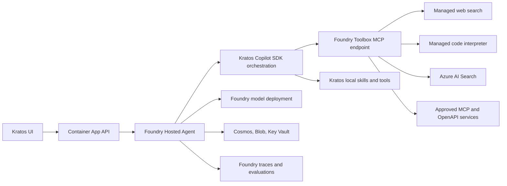

# Foundry Adoption Plan

## Goal

Use more of Microsoft Foundry's managed agent capabilities without replacing Kratos's code-centric orchestration, dynamic personas, custom UI protocol, or existing deployment model.

The target architecture keeps Kratos as a Foundry Hosted Agent and incrementally moves suitable shared capabilities into a Foundry Toolbox. Foundry becomes the managed hosting, model, identity, observability, evaluation, and tool-governance plane. Kratos continues to own persona selection, Copilot SDK orchestration, interactive workflows, and the product-specific event contract.

## Decisions

1. Keep the existing Foundry Hosted Agent and Invocations protocol.
2. Introduce Foundry Toolbox as an additional MCP source consumed by the hosted container.
3. Start with the `generic` persona and low-risk tools.
4. Preserve current tools as a fallback during migration.
5. Require evaluation evidence before making Toolbox the default or expanding it to other personas.
6. Keep prompts and persona routing in source control for now.
7. Defer Graph OBO migration until Foundry identity passthrough is proven end to end.
8. Treat Responses protocol and specialist Foundry agents as later, independent decisions.

## Implementation Status

Last updated: 2026-09-16

- [x] Confirmed Toolbox and Hosted Agent support in Sweden Central.
- [x] Added declarative `kratos-tools` provisioning with managed Web Search.
- [x] Corrected the Bicep project endpoint output to use Azure's `AI Foundry API` endpoint.
- [x] Added disabled-by-default, environment-controlled Toolbox consumption.
- [x] Added renewable managed-identity authentication through the Copilot SDK MCP auth callback.
- [x] Scoped Toolbox consumption to the `generic` persona and removed duplicate local `web_search` exposure while enabled.
- [x] Deployed an active Hosted Agent and Toolbox in the `bankfdry` environment with Toolbox enabled.
- [x] Added focused tests for disabled behavior, persona scoping, and endpoint-scoped authentication.
- [x] Proved an end-to-end generic Web Search invocation through Toolbox; the deployed event stream recorded a successful `kratos-tools-web_search` call with sourced results.
- [x] Fixed the eval CLI scenario filter payload to match the backend `scenarios` contract.
- [x] Confirmed platform-managed Application Insights telemetry after full Hosted Agent recreation; the reserved connection string remains absent from the agent definition and must not be declared there.
- [x] Verified a successful `execute_tool kratos-tools-web_search` dependency span in Application Insights with Foundry agent, project, session, invocation, and GenAI tool dimensions. Authentication succeeded operationally, but no dedicated auth dimension is emitted.
- [x] Recreated the deleted `bankfdry` Hosted Agent instance identity by deleting and redeploying the hosted agent, then reapplied its declarative role assignments; a minimal model invocation returned `OK`.
- [x] Deployed and verified the evaluator adapter in `bankfdry`. A Toolbox run of `generic/web-search-ai-trends` completed in 31.6 seconds, invoked `kratos-tools-web_search`, and scored Coherence 5/5, Relevance 5/5, Intent Resolution 4/5, Tool Call Accuracy 5/5, and Task Adherence 1/5. Task Adherence now executes instead of failing schema validation, and failed/skipped evaluators can no longer produce a false passing run summary.
- [x] Completed the disabled baseline comparison for `generic/web-search-ai-trends` in `bankfdry` and restored Toolbox immediately afterward. The local `web_search` run completed in 30.9 seconds and scored Coherence 5/5, Relevance 5/5, Intent Resolution 4/5, Tool Call Accuracy 5/5, and Task Adherence 1/5, with an aggregate pass. The Toolbox run completed in 31.6 seconds with the same criterion scores except that its aggregate failed because Task Adherence reported a failing pass flag. Deployment-spanning warm-pool sessions can retain the previous agent version, so controlled comparisons must drain the two-session pool before measuring. `bankka` remained untouched.
- [x] Ran the API-only deployed smoke suite against `bankfdry`; it completed successfully.
- [x] Restored backend dependencies through Azure Artifacts; all 83 backend tests pass and focused evaluator lint is clean. Whole-tree Ruff still reports three unrelated existing findings.
- [x] Verified the recreated Hosted Agent identity has only the declared ARM data-plane roles (`Cognitive Services OpenAI User`, `Cognitive Services User`, `Key Vault Secrets User`, and `Storage Blob Data Reader`) plus one Cosmos DB data-plane assignment; Toolbox execution succeeds with this set.

## Current State

Foundry currently provides:

- AI Services account, project, and model deployment.
- Managed Hosted Agent compute with a dedicated endpoint and agent identity.
- Per-session isolation and scale-to-zero behavior.
- Container versioning and lifecycle management.
- Application Insights integration and OpenTelemetry traces.

Kratos currently provides inside the hosted container:

- Persona selection and system prompts.
- Copilot SDK session orchestration.
- Built-in Python tools such as web search, Azure AI Search, code interpreter, CRM, and agent delegation.
- `SKILL.md` discovery and APM package management.
- MCP server discovery and per-user OBO token injection.
- Cosmos-backed application state and the custom SSE event contract.
- Evaluation scenario storage, invocation, scoring, and reporting.

Because the Hosted Agent is bring-your-own code, Foundry cannot introspect its internal Copilot SDK tools. The empty tool list in the Foundry UI is therefore expected. Tools moved into a Toolbox will become Foundry-managed and visible there.

## Target Architecture

Toolbox is additive at first. A tool is removed from the local registry only after its Toolbox replacement passes functional, identity, latency, cost, and evaluation checks.

## Success Criteria

- `azd up` can provision or configure the Toolbox integration without embedding environment-specific endpoints or credentials in the repository.
- Toolbox can be enabled per azd environment and disabled without rebuilding application behavior.
- The generic persona can discover and invoke the pilot Toolbox tools from the Foundry Hosted Agent.
- Existing generic web-search and computation scenarios do not regress.
- Tool calls and failures are observable in Foundry/Application Insights with stable tool names.
- Authentication uses managed identity or Foundry-managed connections; no secrets are added to manifests or images.
- Existing personas, APM skills, MCP integrations, local development, and OBO continue to work when Toolbox is disabled.
- A documented rollback returns traffic to current local tools without infrastructure teardown.

## Non-Goals

- Replacing Kratos with a prompt-only Foundry agent.
- Moving all personas or prompts into the Foundry portal.
- Replacing the frontend or backend proxy.
- Changing the Invocations protocol in the initial work.
- Migrating delegated Microsoft Graph access in the pilot.
- Moving every local file-manipulation or workflow skill into Toolbox.

## Phase 0: Baseline and Compatibility Spike

### Work

- Confirm Toolbox availability, API version, SDK support, and regional availability for the selected azd environment.
- Confirm Hosted Agent access to a Toolbox MCP endpoint using its dedicated agent identity.
- Record the exact Toolbox resource model and determine whether provisioning can be expressed in Bicep or requires a deployment hook/SDK call.
- Capture baseline results for:
  - `generic/web-search-ai-trends`
  - `generic/code-interpreter-math`
  - `generic/data-analysis-with-charts`
- Record response quality, expected tool selection, duration, cold-start impact, token usage where available, and failure behavior.
- Verify current tool-call events contain enough structure for Foundry process evaluators.

### Baseline Exit Criteria

- A supported provisioning and authentication path is identified.
- Baseline eval artifacts are available for comparison.
- No unsupported preview dependency is accepted without an explicit decision and rollback plan.

## Phase 1: Toolbox Foundation

### Infrastructure

- Add a Toolbox associated with the existing Foundry project.
- Surface only non-sensitive Toolbox identifiers/endpoints as Bicep or azd outputs.
- Grant the Hosted Agent identity the minimum roles required to discover and invoke Toolbox tools.
- Prefer Foundry connections and managed identity over keys.
- Keep all deployment-specific values in azd environment outputs or environment variables.

### Runtime

- Add an opt-in configuration such as `FOUNDRY_TOOLBOX_ENABLED=false` and a runtime-resolved Toolbox endpoint/identifier.
- Register Toolbox as one MCP server in the Copilot SDK session configuration.
- Scope the pilot to the `generic` persona.
- Keep existing local tools registered while validating connectivity, but avoid exposing duplicate tool names to the model in the same session.
- Normalize Toolbox events into the existing Kratos `tool_call` stream and OpenTelemetry attributes.
- Fail closed for authentication errors and fall back only when explicitly configured.

### Tests

- Configuration parsing and disabled-by-default behavior.
- Persona scoping.
- MCP configuration construction without secret logging.
- Tool-event normalization.
- Hosted smoke invocation with Toolbox enabled and disabled.

### Foundation Exit Criteria

- Toolbox is deployable repeatedly through the project workflow.
- Enabling it for `generic` does not affect other personas.
- Disabling it restores current behavior without code or infrastructure rollback.

## Phase 2: Pilot Managed Tools

### 2A. Web Search

Move the current web-search capability to Toolbox first.

Benefits:

- Removes the custom Responses API wrapper and endpoint transformation.
- Centralizes tool configuration and governance.
- Makes the tool visible and independently versionable in Foundry.

Acceptance criteria:

- Source citations remain available to the frontend.
- Tool naming remains compatible with existing scenarios or is migrated deliberately.
- Quality and success rate meet or exceed the baseline.
- Added latency and cost are measured and accepted.

### 2B. Code Interpreter

Evaluate Foundry-managed Code Interpreter against the current local Python subprocess.

Benefits:

- Stronger execution isolation and managed lifecycle.
- Better governance than arbitrary subprocess execution inside the Hosted Agent container.
- Potentially better file and execution observability.

Acceptance criteria:

- Numeric and data-analysis scenarios pass.
- Generated files can still be surfaced through the Kratos download flow.
- Required Python package behavior is documented.
- Execution limits, persistence, and cost are acceptable.

Do not remove the local interpreter until file transfer and package compatibility are proven.

## Phase 3: Foundry Evaluation Expansion

The repository already invokes the Hosted Agent and scores scenarios with `azure-ai-evaluation`. Extend this rather than replacing it.

### Evaluation Work

- Normalize captured messages, tool definitions, tool calls, and tool results to Foundry's current evaluation schema.
- Add or enable process evaluators where supported:
  - Tool Selection
  - Tool Input Accuracy
  - Tool Output Utilization
  - Tool Call Success
  - Task Navigation Efficiency
- Retain Task Adherence, Intent Resolution, Relevance, Coherence, and Tool Call Accuracy.
- Compare local-tool and Toolbox runs using the same committed scenarios.
- Link cloud evaluation reports and trace identifiers from Kratos run records.
- Define release thresholds for pilot scenarios and prevent a failed eval from being treated as a successful migration.

### Evaluation Exit Criteria

- Baseline and Toolbox variants can be compared from repeatable runs.
- Tool-level regressions are visible, not hidden inside final-response scores.
- The team has agreed thresholds for quality, reliability, latency, and cost.

## Phase 4: Shared MCP, OpenAPI, and Search Integrations

After the pilot succeeds, move stateless or agent-identity-based integrations that benefit from centralized reuse.

Priority order:

1. Non-user-specific remote MCP servers.
2. Stable internal APIs represented by OpenAPI.
3. Azure AI Search connections where indexes and authorization fit Toolbox's model.
4. Shared workflows suitable for versioned Foundry Skills.
5. A2A delegation to independently owned specialist agents.

For each candidate:

- Identify the owning team and authentication model.
- Decide whether it is global, persona-specific, or environment-specific.
- Preserve least privilege and persona allowlists.
- Run the relevant use-case eval suite before removing the old path.
- Document data residency and third-party data-flow implications.

Local `SKILL.md` workflows should remain in Kratos when they depend on the container filesystem, installed CLIs, custom interactive input, or tight coupling to the Copilot SDK session.

## Phase 5: Graph OBO Identity Spike

Do not migrate the current Graph OBO MCP path as part of the initial Toolbox work.

### Questions to Prove

- Can Toolbox perform OAuth identity passthrough for the signed-in user from this custom frontend and Invocations protocol?
- Is consent handled at the correct tenant and scope?
- Can a user token ever be exposed to an unintended Toolbox tool or MCP endpoint?
- How are token refresh, Conditional Access, audit logs, and revoked consent handled?
- Does the flow work for direct API use as well as future Teams/Microsoft 365 channels?

### Required Security Tests

- No-token and expired-token behavior.
- Wrong audience and wrong tenant rejection.
- Persona/tool allowlist enforcement.
- Confused-deputy attempts using a similarly named MCP server.
- User A cannot access User B's delegated context.
- Tokens never appear in logs, traces, eval artifacts, or tool output.

Only replace the custom OBO injection after these checks pass and the authorization boundary is at least as strong as the current implementation.

## Phase 6: Optional Responses Protocol

Consider adding Responses alongside Invocations after Toolbox is stable. Do not make this a prerequisite for Toolbox.

Potential benefits:

- Foundry-managed conversation history.
- Native conversation and tool-call records.
- Easier playground testing.
- Background execution and cancellation.
- Teams and Microsoft 365 publishing through supported channel bridges.

Costs and risks:

- Translation of the custom SSE event contract.
- Reconciliation with Cosmos conversation mappings.
- Interactive user-input and file-download behavior.
- Frontend and backend proxy changes.
- Migration and coexistence rules for existing conversations.

Proceed only with a separate design and measured product need.

## Phase 7: Optional Specialist Agents

Create separate Foundry agents only where a capability has independent ownership, lifecycle, permissions, or scaling needs. Connect them through A2A or Toolbox.

Do not create one Foundry agent per Kratos persona merely to mirror the current directory structure. Persona configuration should stay lightweight unless separation provides a concrete governance or operational benefit.

## Rollout Strategy

1. Development environment only, Toolbox disabled by default.
2. Enable for the generic persona and internal test users.
3. Run baseline and Toolbox evals repeatedly.
4. Enable one pilot tool at a time.
5. Observe traces, errors, latency, token usage, and cost.
6. Promote only after acceptance thresholds are met.
7. Expand to selected personas and integrations.
8. Remove local implementations only after a full release cycle with no required rollback.

## Rollback Strategy

- Disable Toolbox through the azd environment setting.
- Restore the current local tool allowlist for the affected persona.
- Keep Toolbox infrastructure in place during observation; disabling consumption must be sufficient.
- Preserve existing tool names and event shapes where practical so rollback does not require frontend changes.
- Never couple rollback to deletion of Foundry resources or connections.

## Risks and Mitigations

| Risk | Mitigation |
| --- | --- |
| Toolbox and Skills features change while in preview | Pin supported API/SDK versions, isolate integration code, and keep local fallbacks |
| Duplicate tools confuse model selection | Expose only one implementation of a logical tool per session |
| Persona receives excessive capability | Apply explicit persona allowlists or separate toolboxes |
| Managed tool output differs from current event schema | Normalize at the hosted-agent boundary and cover with contract tests |
| Added network hop increases latency or cost | Benchmark before/after and set acceptance thresholds |
| Tool authentication broadens privileges | Use dedicated agent identity, managed connections, and least-privilege RBAC |
| OBO passthrough weakens user isolation | Defer migration and require dedicated security testing |
| Portal configuration drifts from source control | Provision declaratively where supported and document unavoidable control-plane steps |
| Local development becomes dependent on Azure | Keep Toolbox optional and preserve local implementations |

## First Implementation Slice

The first pull request should contain only the foundation needed to prove one managed tool:

- [x] Document and validate the current Toolbox resource/API support in the target region.
- [x] Add declarative Toolbox provisioning through the Foundry azd extension.
- [x] Add azd outputs and hosted-agent environment configuration without hardcoded endpoints.
- [x] Add an opt-in Toolbox MCP entry for the `generic` persona.
- [x] Configure managed Web Search in Toolbox.
- [x] Preserve the current local web-search implementation behind the disabled/default path.
- [ ] Add focused unit tests for configuration, persona scoping, and event normalization. Configuration, scoping, and authentication tests are present; event normalization coverage remains.
- [ ] Run the existing `web-search-ai-trends` scenario in both modes and record the comparison.
- [ ] Run backend tests/lint and the API-only deployed smoke suite.

Code Interpreter belongs in a follow-up pull request because file transfer and execution semantics require separate validation.

## Open Decisions Before the First Edit

- Which azd environment and region will host the pilot?
- Is the current Foundry Toolbox feature/API available there and suitable for production, or preview-only?
- Can Toolbox resources and tool connections be provisioned through Bicep at the required API version?
- What latency, quality, success-rate, and cost deltas are acceptable?
- Should the pilot use one project-wide Toolbox with persona filtering or a dedicated generic-persona Toolbox?

Default recommendation: begin with a dedicated pilot Toolbox in a non-production azd environment. This gives the clearest authorization and rollback boundary while the integration is being learned.
